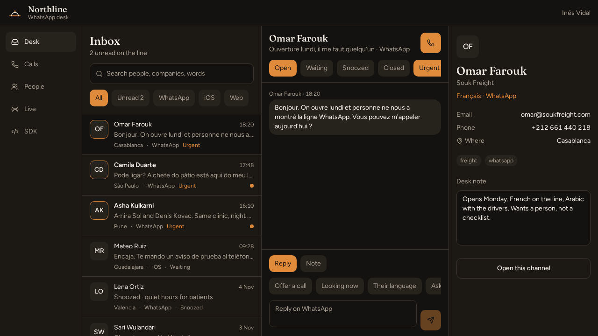
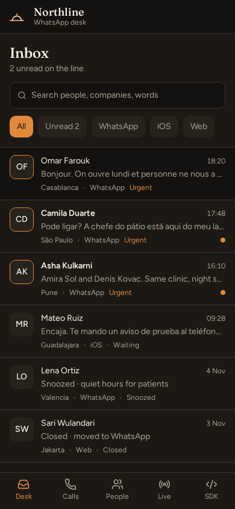

# Northline

WhatsApp-first support desk and client SDK for markets where an Intercom-style website chat never became how customers ask for help.

Intercom, Zendesk chat, and the tools built in their image assume a US or UK SaaS company. The customer is expected to open a site, find a launcher, and type in English. Seat prices start high enough that a two-person clinic or yard never buys one.

In Iberia, Latin America, MENA, India, and Southeast Asia the customer already has the business on WhatsApp. They call. They write in their own language. The website widget is a fallback, not the front door.





Northline is the desk for that line, plus the same client for a driver or clinic iOS app and for the rare person who still writes from a browser.

## What the desk does

One workspace. Three ways in. One thread per person and channel.

- **Inbox.** Search, unread, and filters for WhatsApp, iOS, and web. Status is open, waiting, snoozed, or closed. Urgent is a flag, not a queue.
- **Thread.** Agent replies go back to the customer. Notes stay on the desk. Macros cover the lines a small team repeats: offer a call, look now, stay in their language, ask for a photo of the label.
- **Calls.** Inbound ring, outbound place, answer, mute, end. The call sits on the same conversation as the chat. This build simulates the line. It does not place a carrier call.
- **People.** Name, company, city, language, phone, and a private note.
- **Live.** WhatsApp, the in-app messenger, and the site widget. They call the same client the desk uses. A message sent as Camila or Omar lands in the inbox.
- **SDK.** Copyable usage for WhatsApp, iOS, and web, plus the NorthlineKit sources.

The sample workspace is **Ruta Norte**, run by **Inés Vidal**. Replies are in the customer's language. Notes are in English so a mixed desk can read them.

| Person | City | Language | Channel | Why they wrote |
| --- | --- | --- | --- | --- |
| Omar Farouk, Souk Freight | Casablanca | Français | WhatsApp | Opens Monday and wants a person on the phone |
| Camila Duarte, Frio Sul | São Paulo | Português | WhatsApp | Chilled freight stuck at the gate |
| Asha Kulkarni, Helio Clinic | Pune | English | WhatsApp | Night shift sharing one phone, doctor not on the line |
| Mateo Ruiz, Andén Rojo | Guadalajara | Español | iOS app | Arrival alerts silent on the driver app |
| Lena Ortiz, Clínica Ortiz | Valencia | Español | WhatsApp | Patients woken by night messages |
| Sari Wulandari, Toko Kite | Jakarta | Bahasa | Web | Customers never open the site, so the shop moved to WhatsApp |

## Run it

Node 22 or newer.

```bash
npm install
npm run dev
```

The desk serves on port 8080. Data lives in the browser (`localStorage` key `northline-desk-v2`). **SDK → Reset sample desk** restores the six threads.

```bash
npm run typecheck
npm run build
```

No database is required for the desk. Auth tables exist for the host scaffold and are unused by the sample inbox.

## Client

Web, iOS, and the WhatsApp bridge share one shape. The preview runs an in-browser transport so the desk and the Live devices stay on one conversation. Point the same calls at HTTPS when you leave the demo.

App id in the sample: `nl_live_fieldwork`.

### Web

```html
<script src="https://cdn.northline.dev/sdk.js" data-app-id="nl_live_fieldwork" data-channel="web" async></script>
<script>
  Northline.identify("web", {
    userId: "cus_sari",
    name: "Sari Wulandari",
    email: "sari@tokokite.id",
    company: "Toko Kite"
  });
  Northline.send("web", "cus_sari", "Pelanggan kami cuma buka WhatsApp.");
  Northline.startCall("web", "cus_sari");
</script>
```

`cdn.northline.dev` is a placeholder. The script in this repository is the module at `src/sdk/northline.ts`.

### iOS — NorthlineKit

Swift package, iOS 17, Swift tools 5.9. In Xcode: File → Add Package Dependencies → Add Local… → `ios/NorthlineKit`.

```swift
import SwiftUI
import NorthlineKit

Northline.shared.start(
    appId: "nl_live_fieldwork",
    baseURL: URL(string: "https://example.com")!
)

try await Northline.shared.identify(NorthlineUser(
    userId: "cus_mateo",
    name: "Mateo Ruiz",
    email: "mateo@andenrojo.mx",
    company: "Andén Rojo"
))

NorthlineMessenger()
try await Northline.shared.startCall()
```

`NorthlineMessenger` is the in-app screen. It sends, polls for replies every few seconds, and can ring the desk. `example.com` stands in for your API host. Swap it. Do not ship the placeholder.

The package was not compiled in the environment that produced this repository. Tests are in `ios/NorthlineKit/Tests` and run under Xcode (`identify`, `send`, `startCall` against a scripted transport).

### WhatsApp

Map a Cloud API webhook onto `ingestWhatsApp` after you verify the Meta signature.

```ts
import { Northline } from "@northline/sdk";

export async function POST(req: Request) {
  const update = await req.json();
  const value = update.entry?.[0]?.changes?.[0]?.value;
  const message = value?.messages?.[0];
  const name = value?.contacts?.[0]?.profile?.name ?? "WhatsApp";
  if (!message) return new Response("ok");

  if (message.type === "text") {
    Northline.ingestWhatsApp({
      from: message.from,
      name,
      text: message.text.body
    });
  }

  if (message.interactive?.button_reply?.id === "call") {
    Northline.ingestWhatsApp({ from: message.from, name, call: true });
  }

  return new Response("ok");
}
```

This repository does not include a Meta app, a phone number, or a token. Those are created in Meta.

## HTTP contract

NorthlineKit speaks JSON over HTTPS. Header on every request: `X-Northline-App-Id`.

| Call | Method and path | Body | Response |
| --- | --- | --- | --- |
| Identify | `POST /v1/customers/identify` | `{ appId, channel, user }` | `{ customerId, conversationId }` |
| History | `GET /v1/conversations/:id/messages` | | `{ messages, call }` |
| Send | `POST /v1/conversations/:id/messages` | `{ body }` | message `{ id, body, author, role, at }` |
| Start call | `POST /v1/conversations/:id/calls` | `{}` | `{ id, phase }` |
| Answer | `POST /v1/calls/:id/answer` | `{}` | call |
| End | `POST /v1/calls/:id/end` | `{}` | empty |

`channel` is `web`, `ios`, or `whatsapp`. `role` is `customer`, `agent`, or `system`. `phase` is `ringing`, `active`, or `ended`. `at` is Unix milliseconds. `user` is `{ userId, name, email?, phone?, company? }`.

There is no server in this repository that implements those routes. The desk preview stores threads locally. The iOS package is the client you point at an API when you build one.

## Methods

| Method | Who calls it | What it does |
| --- | --- | --- |
| `identify(channel, user)` | Customer runtime | Attach a known person, or create them |
| `send(channel, userId, body)` | Customer runtime | Open or continue their thread |
| `reply(conversationId, body)` | Desk | Agent reply, delivered back to the widget |
| `note(conversationId, body)` | Desk | Private. Never sent to the customer SDK |
| `startCall(channel, userId)` | Customer | Rings the desk |
| `placeCall(conversationId)` | Desk | Rings the customer |
| `ingestWhatsApp({ from, name, text, call })` | Webhook | Text becomes a thread. `call: true` rings the desk |
| `subscribe(listener)` | Either | `message`, `call`, `identify`, `note`, `status` |

## Layout

```
src/components/     desk, calls, people, live devices, SDK page
src/lib/store.ts    shared state
src/lib/seed.ts     Ruta Norte sample
src/sdk/northline.ts
ios/NorthlineKit/   Swift package
```

## What is a demo

- Threads persist in this browser only.
- Voice is a timer and a banner, not a media provider. Attach LiveKit or a carrier when you need a real line.
- WhatsApp delivery is the webhook shape, not a connected Meta number.
- The hosted script URL and `example.com` are not live hosts.

## License

MIT. See [LICENSE](LICENSE).
